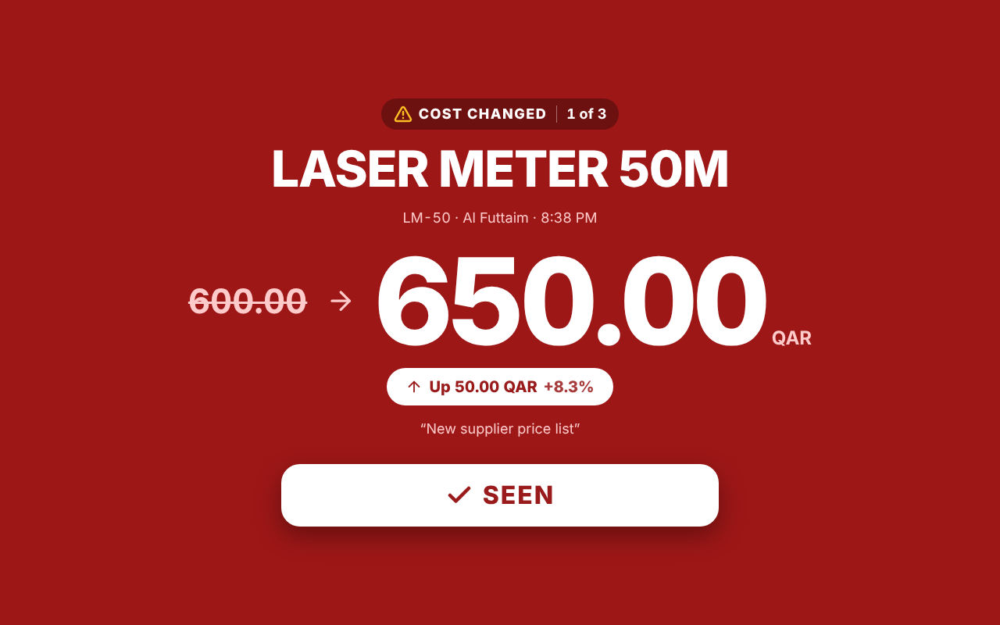

# Cost Alert — Design System (v1.6.0)

A dark **signal board** for a hardware shop counter. The rule behind every decision:

> **Calm by default, loud only when it matters.** If everything on screen is bright, nothing stands out.
> The board stays quiet and neutral, so a cost-change alert is the single loudest thing staff will see.

## 1. How the alert gets attention

| Channel | What happens | Why |
|---|---|---|
| Sound (v1.6) | Bell chime "ding-ding-ding": rising G5 → C6 → E6 (a major chord), played twice (~3 s), repeats every 10 s until **Seen**. Peak −0.9 dBFS, no clipping. [Listen](docs/alarm-chime.wav) | Clear in a busy shop and works when staff aren't looking, but sounds like a shop announcement, not an emergency siren |
| Colour | Full-screen red scrim, slowly pulsing | Red = stop / warning in every culture |
| Simplicity (v1.5) | Only four things on screen: what changed, the product, a giant new price (up to 160 px) with the up/down chip, and one **SEEN** button | One glance from across the counter is enough. Nothing competes with the price |
| Contrast | White text straight on the red, at least 7.4:1 even at the brightest point of the pulse | Readable at any moment of the pulse |
| Taskbar | Tab title flashes "⚠ COST CHANGED ⚠", favicon turns red | Visible even when the sales software is in front |
| Windows notification (v1.4) | Pops over every app, even with Chrome minimised, and stays until answered. **Seen** button confirms and stops the alarm. | Staff don't need to switch windows to see or confirm a change |
| Focus | Keyboard focus lands on **Seen**, Enter confirms | Fast for a cashier with hands on the keyboard |
| Queue | "1 of 3" counter | Staff know how many are left |
| Sound switch (v1.5) | Staff can switch the alarm sound off. It switches back on by itself after 30 min, and the alert says "Alarm sound is off until 9:07 PM" | Quiet when needed, but a forgotten mute can't hide a change |

**Flash safety:** the pulse runs at 0.67 cycles/s, well below the WCAG 2.3.1 limit of 3 flashes per second.
With *reduced motion* switched on in the OS, the pulse stops and a static red is shown.

## 2. Colour tokens

| Token | Hex | Use |
|---|---|---|
| `--bg` | `#020617` | Page background |
| `--surface` / `--surface-2` / `--surface-3` | `#0F172A` / `#1E293B` / `#273449` | Cards / inputs / hover |
| `--border` | `#334155` | Decorative dividers |
| `--border-input` | `#64748B` | Control boundaries (3.07:1) |
| `--text` / `--text-2` / `--text-muted` | `#F8FAFC` / `#CBD5E1` / `#94A3B8` | Primary / secondary / helper text |
| `--brand` / `--on-brand` | `#FBBF24` / `#0F172A` | Primary actions, brand mark, "New" / "Current" tags |
| `--up` | `#F87171` | Cost **up** (bad for margin) |
| `--down` | `#4ADE80` | Cost **down** |
| `--a-scrim` / `--a-pulse` | `#450A0A` / `#B91C1C` | Alert background and its pulse |
| `--a-soft` | `#FECACA` | Secondary text on the alert (old cost, code, note) |
| `--a-up-ink` / `--a-down-ink` | `#991B1B` / `#166534` | **SEEN** button text and up/down chip text on white |

Direction is **never shown by colour alone**: there's always an arrow icon, the word "Up"/"Down" and a +/− sign.

### Measured contrast (WCAG 2.1)
| Pair | Ratio | Need |
|---|---|---|
| Text on background | 19.28 | 4.5 |
| Muted text on input surface | 5.71 | 4.5 |
| Ink on amber (buttons, alert header) | 10.69 | 4.5 |
| Up red on card | 6.45 | 4.5 |
| Down green on card | 10.25 | 4.5 |
| Alert: white text on red (darkest → brightest pulse) | 7.45 or more | 4.5 |
| Alert: soft text `#FECACA` on red | 5.15 or more | 4.5 |
| **SEEN** button text / up chip on white | 8.31 | 4.5 |
| Down chip on white | 7.13 | 4.5 |
| Input border on input surface | 3.07 | 3.0 |
| Amber focus ring on background | 12.08 | 3.0 |

## 3. Typography
**Inter** (Google Fonts, `display=swap`) with system fallbacks. Prices use **tabular figures**, so the digits don't jump when values change.

| Role | Size | Weight |
|---|---|---|
| Alert new price | clamp(64 px, 12vw, 160 px) | 800 |
| Board new price | clamp(36 px, 3.6vw, 56 px) | 800 |
| Alert product name | clamp(32 px, 5vw, 72 px) | 800 |
| Board product name | clamp(24 px, 2.4vw, 36 px) | 800 |
| Section / card title | 20 px | 700 |
| Body / inputs | 16 px (never smaller on phones → no iOS zoom) | 400–600 |
| Labels / meta | 14 px | 600 |
| Overlines / chips | 12 px, uppercase, +0.06em | 700 |

Sizes are in `rem`, so browser zoom and system text size still work.

## 4. Spacing, shape, layers
- **Spacing (4/8-pt grid):** 4 · 8 · 12 · 16 · 24 · 32 · 48 · 64 px. Page gutter `clamp(16px, 3vw, 32px)`.
- **Radius:** 8 · 12 · 16 · 24 px, plus pill.
- **Z-index:** header 10 · alert 100 · start screen 200 · toast 300.

## 5. Touch & interaction
- Every control is at least **48 × 48 px** (Material). **SEEN** is 80 px tall (72 px on phones), **Start board** 72 px.
- Controls are at least 8 px apart.
- Visible 3 px focus ring: amber on the board, white on the red alert.
- The sound button is a real switch (`role="switch"`, `aria-checked`), with an on/off track you can see.
- Buttons show a spinner and are disabled while saving.
- Press feedback is `scale(.98)`, so the layout never shifts.
- Deleting asks for confirmation. Delete is a red icon button, separate from the primary action.

## 6. Motion
| Token | Value | Used for |
|---|---|---|
| `--dur-fast` | 150 ms | Hover, press |
| `--dur-base` | 250 ms | Alert card entrance (scale .96 → 1 + fade) |
| Alarm pulse | 750 ms alternate | Red scrim only |

Only `opacity` and `transform` are animated. `prefers-reduced-motion` turns all of it off.

## 7. Icons
Lucide (ISC licence), inline SVG sprite, 2 px stroke, one style everywhere. No emoji in the UI.
Decorative icons are `aria-hidden`. Icon-only buttons have an `aria-label`.

## 8. Responsive
Breakpoints: **375 · 768 · 1024 · 1440**, with the alert scaled for **1920** TVs.
- **< 1024 px:** admin becomes one column.
- **< 768 px:** buttons become icon-only (still labelled for screen readers), tables become stacked cards, board rows drop the direction badge (the colour bar and arrow chip carry direction), and the alert wraps the old price above the new one.
- **< 480 px:** the in-app clock is hidden (phones show the time already).
- No horizontal scrolling at 375 px (checked automatically).
- Landscape phones can scroll to **Seen**.

## 9. Accessibility
- The alert is `role="alertdialog"` + `aria-modal`. The page behind it is `inert`, and Tab stays on **Seen**.
- Tabs use `role="tablist"` / `tab` / `tabpanel` with `aria-selected`.
- Status messages use `aria-live`. Login errors use `role="alert"`.
- Every input has a visible label, required fields are marked `*`, and the password field has a show/hide toggle.

## 10. Pre-delivery checklist (v1.5.0)
- [x] Contrast measured, all text ≥ 4.5:1
- [x] Touch targets ≥ 48 px, automated check passed on every screen
- [x] No horizontal scroll at 375 px
- [x] Tested at 375 × 812, 812 × 375 (landscape), 1280 × 800, 1920 × 1080
- [x] Reduced motion respected (pulse 0 s, static scrim)
- [x] Flashing below 3 per second
- [x] SVG icons only, one family
- [x] Keyboard: focus moves to **Seen**, Enter confirms, Tab is trapped in the alert
- [x] No JavaScript errors

Dark-only by design: it's a signage-style board, and a dark rest state makes the alert stand out more.
