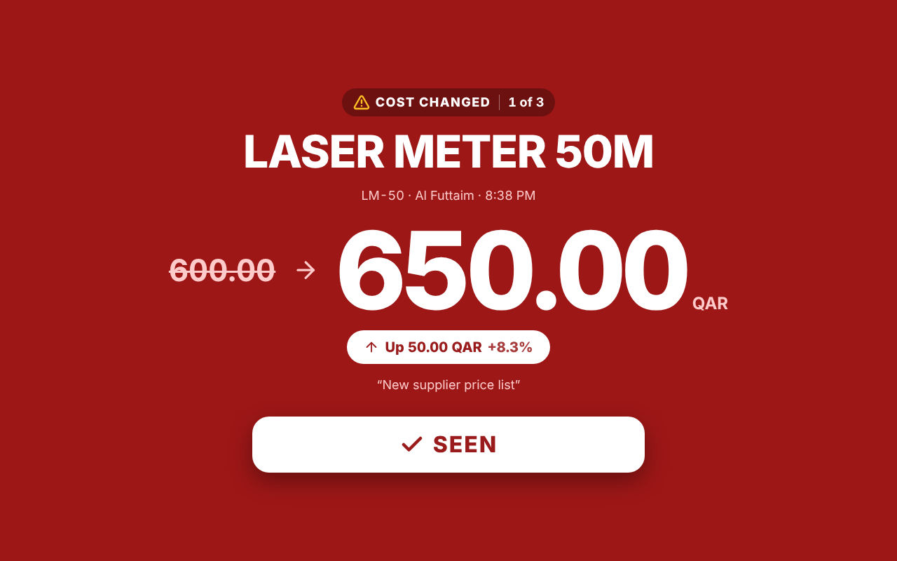
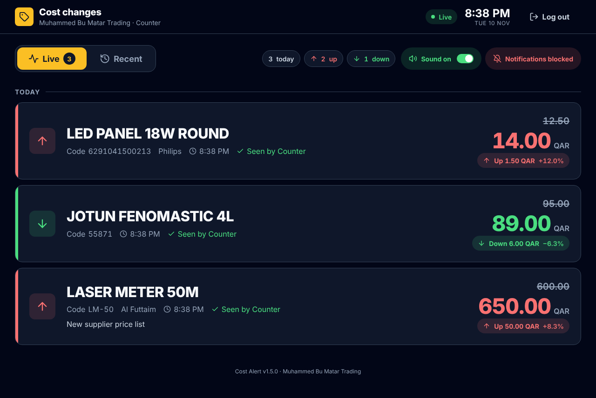

# Cost Alert

Cost-change alert board for **Muhammed Bu Matar Trading**.

**Live:** https://fayisc.github.io/cost-alert/

- **Admin** (office): scan or type a product, enter the new cost, save.
- **Staff** (counter, other office, phone): full-screen board that sounds an alarm and shows a pop-up — old cost → new cost — until they press **SEEN**.
- **Recent** tab: staff scan a barcode or type a name to see a product's cost history.
- Works on any Wi-Fi or network; only internet is needed.

| Staff alert | Staff board |
|---|---|
|  |  |

Design rules, colours, sizes and the accessibility checklist are in **[DESIGN.md](DESIGN.md)**.

## How it's built
| Part | Where |
|---|---|
| Website | `index.html` — one file, hosted on GitHub Pages |
| Database | Supabase (project `nr-warehouse`, tables starting with `ca_`) |
| Database setup | `supabase/cost_alert_setup.sql` (run once in Supabase SQL Editor) |

The Supabase key in `index.html` is the public *publishable* key. It is safe to publish: the tables are locked and every action goes through functions that check the login.

## First use
1. Open the live link in Chrome or Safari (not inside an app preview).
2. First-time setup: create the admin login (6+ character password).
3. Admin page → **Logins** → add staff.
4. On each staff screen: log in → **START BOARD** (plays a sound check) → keep the volume up.

## Counter PC setup (do once per PC)
**1. Allow notifications.** Open the link in Chrome, log in as staff, tap **Start board**, then click **Allow** when Chrome asks.
The board should show green **Sound on** and **Notifications on**. Tap them to test.

**2. Windows settings.** Go to **Settings → System → Notifications**:
- **Google Chrome** must be **On**.
- **Do not disturb** must be **Off**.
- Under the automatic rules, untick *"When using an app in full-screen mode"*. Otherwise Windows hides notifications while the sales software is full screen.

**3. Stop staff closing it: a shortcut that opens the board on its own.** Close Chrome completely, then on the desktop: right-click → **New → Shortcut**, and paste one of these:

| Counter set-up | Shortcut target |
|---|---|
| Board on its own screen / TV (full screen, no close button) | `"C:\Program Files\Google\Chrome\Application\chrome.exe" --kiosk --autoplay-policy=no-user-gesture-required https://fayisc.github.io/cost-alert/` |
| Same PC as the sales software (small window, can be minimised) | `"C:\Program Files\Google\Chrome\Application\chrome.exe" --app=https://fayisc.github.io/cost-alert/ --autoplay-policy=no-user-gesture-required` |

`--autoplay-policy=…` lets the alarm sound after a restart without anyone tapping START.

**4. Open it on every start-up.** Press **Win + R**, type `shell:startup`, Enter, and copy the shortcut into that folder.

Notifications only work while the board is open (minimised is fine). If Chrome is fully closed, nothing can alert.

**Sound on/off:** staff can turn the siren off with the **Sound** switch on the board. It turns back on by itself after 30 minutes.

**No sound?** Check the **Sound** button on the board. Tap it if it's amber or red. Make sure the speaker is on and not muted, and that the Chrome tab isn't muted (right-click the tab).

## Releasing a new version
1. Make the change in `index.html`.
2. Bump `APP_VERSION` in `index.html` **and** `version` in `version.json` (same number).
3. Add an entry at the top of `CHANGELOG.md`.
4. Commit, tag (`git tag v1.2.0`) and push with tags.

Open boards check `version.json` every 5 minutes and show **"New version available — tap to update"**.
